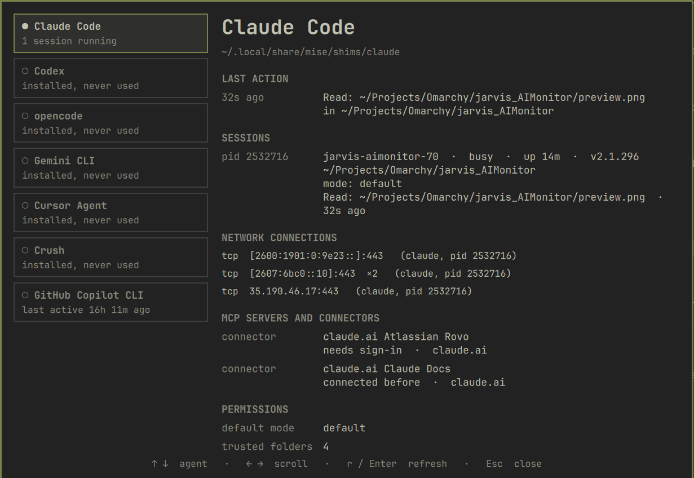
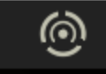

# Jarvis AI Monitor

AI agent monitor plugin for the Omarchy shell. It puts one icon in the top bar and opens a panel that answers four questions about the AI coding agents on the machine: which ones are installed, what they are connected to, what they are allowed to do, and what they did last.

No sudo or pkexec is required. The plugin itself opens no network connection.



| Bar icon |
|---|
|  |

## What it shows

The panel lists every agent found, and for the selected one:

| Section | Content |
|---|---|
| Last action | the most recent tool call or reply, when it happened and in which folder |
| Sessions | each running session: pid, name, busy or idle, uptime, version, working folder, permission mode, its own last action |
| Network connections | TCP and UDP sockets open by the session and by every process it spawned, grouped by remote endpoint |
| MCP servers and connectors | configured servers with type, target and the scope that declares them |
| Permissions | default mode, allow, ask and deny rules per scope (managed, user, project), trusted folders |

Agents detected:

| Agent | Binary | Detail level |
|---|---|---|
| Claude Code | `claude` | sessions, permission mode, rules, MCP, connectors, last tool call |
| Codex | `codex` | approval and sandbox policy, trusted projects, MCP, last thread |
| opencode | `opencode` | permission config, MCP, last activity time |
| Gemini CLI | `gemini` | allowed and excluded tools, MCP, last activity time |
| Cursor Agent | `cursor-agent` | allow and deny rules, MCP, last activity time |
| Crush | `crush` | allowed tools, MCP, last activity time |
| GitHub Copilot CLI | `copilot` | trusted folders, MCP, last activity time |

An agent appears when its binary is on `PATH` or when it is running. Running sessions and their network connections are detected the same way for all of them.

## Bar icon

The icon is drawn by the plugin (`JarvisIcon.qml`) as vectors in a single color, the bar foreground of the active theme, so it follows theme changes like the glyph icons next to it.

| State | Appearance |
|---|---|
| No agent running | dimmed |
| An agent is running | full foreground color |
| An agent is working | the outer ring turns |
| A session runs without permission prompts | the theme's urgent color |

The tooltip summarizes the running sessions and the most recent action.

## Architecture

The plugin is a single `bar-widget` made of seven files:

| File | Role |
|---|---|
| `manifest.json` | plugin metadata and entry point |
| `BarWidget.qml` | bar icon, IPC handler, host of the panel |
| `JarvisIcon.qml` | the vector bar icon |
| `Collector.qml` | runs `collect.py` on a timer and exposes its snapshot |
| `collect.py` | finds the agents and prints one JSON snapshot (Python standard library only) |
| `Panel.qml` | agent list and detail view |
| `Model.js` | pure formatting functions |

Data flow: `Collector` starts `collect.py` every interval and parses the JSON it prints. `BarWidget` and `Panel` only read properties from the collector. All colors, fonts and spacing come from the shell theme tokens (`Color`, `Style`).

Each bar surface creates its own widget instance, so on a multi-monitor setup there is one collector per monitor. One `collect.py` run takes under 0.1 second.

## Files read and processes started

The plugin reads only, and writes nothing outside memory. It never contacts an agent or its provider.

Read on every interval (default 5 seconds, 2 seconds while the panel is open):

- `/proc/<pid>/cmdline`, `/proc/<pid>/stat` and `/proc/<pid>/cwd` of the processes the user may read
- Claude Code: `~/.claude.json`, `~/.claude/settings.json`, `~/.claude/sessions/`, `~/.claude/mcp-needs-auth-cache.json`, the tail of the session transcripts under `~/.claude/projects/`, `/etc/claude-code/managed-settings.json`, and `.claude/settings.json`, `.claude/settings.local.json` and `.mcp.json` in the folder of each running session
- Codex: `~/.codex/config.toml`, `~/.codex/state_5.sqlite` (read-only) and the tail of the last thread's rollout file
- opencode: `~/.config/opencode/opencode.json`
- Gemini CLI: `~/.gemini/settings.json`
- Cursor Agent: `~/.cursor/cli-config.json`, `~/.cursor/mcp.json`
- Crush: `~/.config/crush/crush.json`
- GitHub Copilot CLI: `~/.copilot/config.json`, `~/.copilot/mcp-config.json`
- modification times under each agent's session or log folder, for the last activity time

Short-lived child processes:

- `python3 collect.py` on every interval
- `ss -Htunap` once per run, to list sockets and the process that owns each

The panel shows the last command or file an agent touched, taken from its own session files. That text stays in memory and is not stored or sent anywhere.

## Install

```bash
omarchy plugin add https://github.com/FernandoTechSpace/jarvis-ai-monitor-omarchy.git --enable
```

Plugins run inside the shell process without sandboxing. Review the code before enabling it.

For manual installation, clone the repository to `~/.config/omarchy/plugins/fernando.jarvis-ai-monitor`, then run:

```bash
omarchy-shell shell rescanPlugins
omarchy plugin enable fernando.jarvis-ai-monitor
```

## Use

| Action | Result |
|---|---|
| Click the bar icon | open or close the panel |
| Middle click the bar icon | refresh now |
| Up and down arrows, or `j` `k` | select an agent |
| `1` to `9` | jump to an agent |
| Left and right arrows, or `h` `l` | scroll the detail view |
| `r` or `Enter` | refresh now |
| `Tab` | move to the neighboring bar panel |
| `Esc` | close |

To open the panel with a shortcut, bind the shell toggle in `~/.config/hypr/bindings.lua`:

```lua
o.bind("SUPER + ALT + A", "Jarvis AI Monitor", "omarchy-shell shell toggle fernando.jarvis-ai-monitor '{}'")
```

The IPC target `fernando.jarvis-ai-monitor` also accepts `open`, `close`, `toggle` and `refresh`.

## Configure

The refresh interval, in milliseconds, is set on the widget entry in `~/.config/omarchy/shell.json`:

```json
{ "id": "fernando.jarvis-ai-monitor", "interval": 5000 }
```

## Update and remove

```bash
omarchy plugin update fernando.jarvis-ai-monitor
omarchy plugin remove fernando.jarvis-ai-monitor
```

## Requirements and limits

- Omarchy with the shell plugin system, `python3` 3.11 or newer and `ss` (iproute2).
- Only Claude Code has been validated against real session data. The other agents are read from their documented config locations and may need adjustment as their formats change.
- Network connections are shown as address and port, without reverse DNS, and only for processes of the current user.
- Busy or idle status and the live permission mode are reported by Claude Code only. For the other agents the mode comes from their config and command-line flags.
- Permission rules reflect what the config files declare. Approvals granted interactively during a session are not listed.

## Development

Edits through a symlink are not hot-reloaded. After changing a file, restart the shell:

```bash
omarchy-restart-shell
```

Validation:

```bash
omarchy plugin validate .
```

The collector can be run on its own:

```bash
./collect.py | python3 -m json.tool
```

## License

MIT
